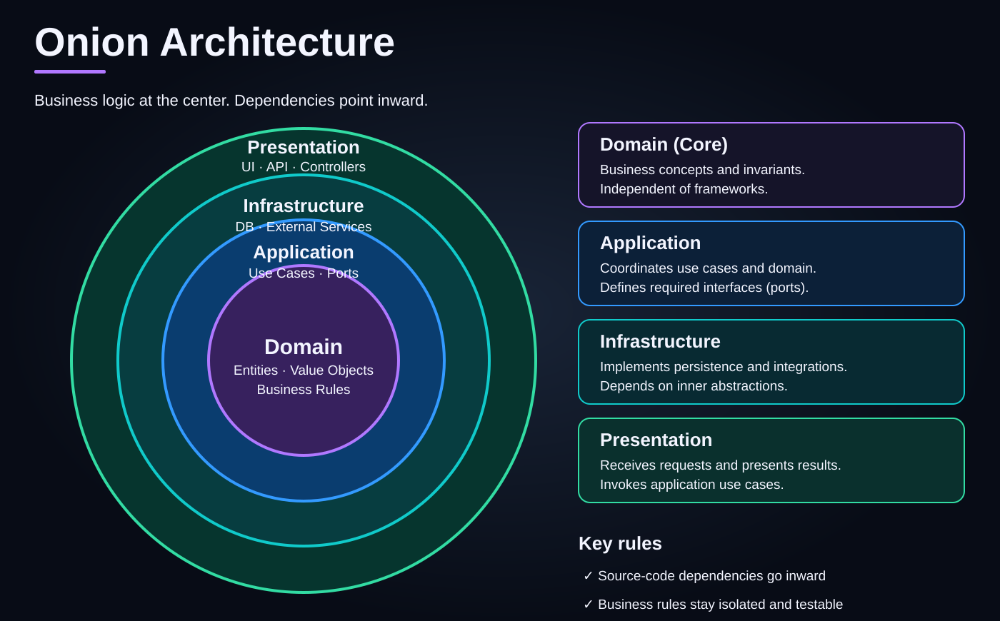
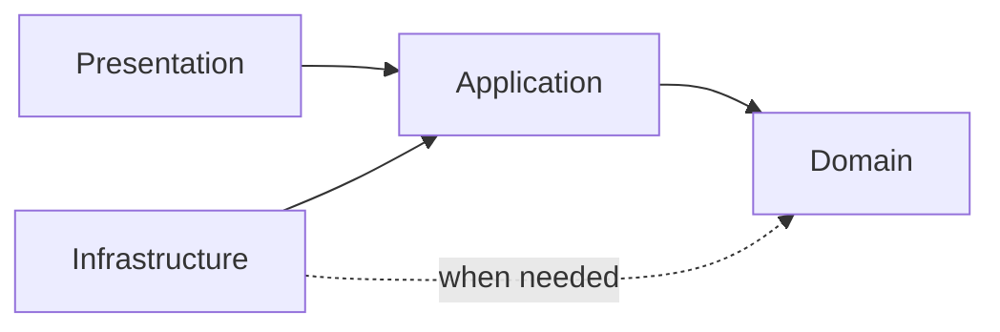
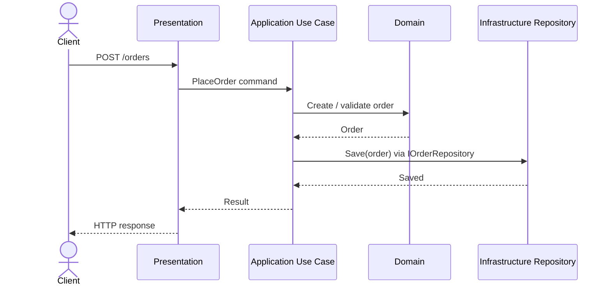

# Onion Architecture 🧅

> **Business rules at the center. Technology at the edges.**

Onion Architecture is a software design approach that puts the **Domain Model** at the center of an application and arranges other concerns around it. The key idea is the **Dependency Rule**: source-code dependencies should point **inward**, toward the business model, rather than outward toward databases, web frameworks, or external APIs.

<p align="center">
  
</p>

> This repository is an **educational reference**. It currently explains the architecture rather than containing a runnable application.

## Table of Contents

- [Why Onion Architecture?](#why-onion-architecture)
- [The Layers](#the-layers)
- [The Dependency Rule](#the-dependency-rule)
- [Runtime Flow vs. Source Dependencies](#runtime-flow-vs-source-dependencies)
- [A Practical Example](#a-practical-example)
- [Suggested Project Structure](#suggested-project-structure)
- [Testing Strategy](#testing-strategy)
- [Benefits and Trade-offs](#benefits-and-trade-offs)
- [When to Use It](#when-to-use-it)
- [Further Reading](#further-reading)

## Why Onion Architecture?

In a conventional application, business decisions can become tangled with controllers, SQL queries, and framework-specific code. That makes business rules hard to test and risky to change.

Onion Architecture separates *what the system does* from *how it communicates with the outside world*.

The goals are to:

- Make domain rules understandable and independently testable.
- Avoid coupling the core to a particular database, framework, or vendor.
- Keep application use cases explicit.
- Allow new delivery mechanisms and infrastructure implementations with fewer changes to business behavior.

## The Layers

The four-layer model below is a useful teaching convention. Actual projects may combine or split layers; the important property is the direction of dependencies.

| Layer | Responsibility | Typical contents |
| --- | --- | --- |
| **Domain** (center) | Model business concepts and enforce invariants | Entities, value objects, domain services, domain events |
| **Application** | Coordinate user or system use cases | Commands/queries, use-case handlers, ports/interfaces, transaction boundaries |
| **Infrastructure** | Connect to technology and third-party systems | Database access, repository implementations, messaging, email, external API clients |
| **Presentation** (edge) | Accept input and return output | HTTP endpoints, controllers, request/response mapping, CLI handlers |

### 1. Domain — the center

The Domain contains the rules that remain meaningful even if the database or web framework is replaced.

For example, an `Order` might prohibit checkout without any items. That rule belongs in the Domain, not in a controller or SQL procedure.

**Keep out:** ORM annotations tied to a particular provider (when they introduce coupling), HTTP request objects, SQL clients, framework-specific application services.

### 2. Application — the use cases

The Application layer expresses actions such as `PlaceOrder`, `CancelOrder`, or `GetOrderHistory`. It orchestrates domain objects and communicates through abstractions, often called **ports**.

For example, an `IOrderRepository` interface may be declared here, while its SQL implementation lives in Infrastructure. Depending on the design, repository abstractions may instead reside in the Domain.

### 3. Infrastructure — the adapters

Infrastructure provides technical implementations behind the ports: a PostgreSQL repository, a payment gateway client, a message publisher, or a file store. These implementations **depend on inner interfaces**, not the other way around.

### 4. Presentation — the entry points

Presentation translates outside requests into use-case inputs and translates results into responses. For a web app it might expose REST endpoints; another client might be a CLI or message consumer.

> **Clarification:** Presentation and Infrastructure are both outer concerns. They are not required to depend on each other, and their exact order in a diagram is a convention. The diagram illustrates responsibilities, not a mandatory project-reference chain.

## The Dependency Rule

**Code dependencies point inward.** Inner code must not import or reference outer-layer implementations.



**Allowed:** Application → Domain; Infrastructure → Application abstractions; Presentation → Application.

**Avoid:** Domain → database SDK; Application → concrete SQL repository; Domain → HTTP framework.

This works through **Dependency Inversion**: inner layers declare the contracts they need; outer layers implement them. At runtime, dependency injection wires the pieces together.

## Runtime Flow vs. Source Dependencies

A request can move through a system in both directions even though **source-code dependencies always point inward**.



The repository call crosses an interface. **The Application references `IOrderRepository`; the concrete infrastructure adapter references and implements that interface.** The diagram above shows *runtime communication*, not assembly references.

## A Practical Example

Imagine an ordering system written in C# (illustrative code; this repository does not yet provide a compiled solution).

**Domain: business invariant**

```csharp
// Domain/Order.cs
public sealed class Order
{
    private readonly List<string> _items = new();
    public IReadOnlyList<string> Items => _items;

    public void AddItem(string sku)
    {
        if (string.IsNullOrWhiteSpace(sku))
            throw new ArgumentException("SKU is required.");
        _items.Add(sku);
    }

    public void EnsureReadyForCheckout()
    {
        if (_items.Count == 0)
            throw new InvalidOperationException("Cannot place an empty order.");
    }
}
```

**Application: define a port and a use case**

```csharp
// Application/IOrderRepository.cs
public interface IOrderRepository
{
    Task SaveAsync(Order order, CancellationToken ct);
}

// Application/PlaceOrder.cs
public sealed class PlaceOrder(IOrderRepository orders)
{
    public async Task ExecuteAsync(IEnumerable<string> skus, CancellationToken ct)
    {
        var order = new Order();
        foreach (var sku in skus) order.AddItem(sku);

        order.EnsureReadyForCheckout();
        await orders.SaveAsync(order, ct);
    }
}
```

**Infrastructure: implement the port**

```csharp
// Infrastructure/SqlOrderRepository.cs
public sealed class SqlOrderRepository : IOrderRepository
{
    public Task SaveAsync(Order order, CancellationToken ct)
    {
        // Translate the domain object into database operations.
        // Real persistence would be implemented here.
        throw new NotImplementedException();
    }
}
```

**Composition root: connect the pieces**

```csharp
// Host/Program.cs (illustrative ASP.NET Core registration)
services.AddScoped<IOrderRepository, SqlOrderRepository>();
services.AddScoped<PlaceOrder>();
```

The business rule for an empty order is testable without a database or web server. Changing the storage adapter does not require rewriting it.

## Suggested Project Structure

A typical .NET solution might look like this:

```text
src/
├── MyApp.Domain/
│   ├── Entities/
│   ├── ValueObjects/
│   └── Services/
├── MyApp.Application/
│   ├── UseCases/
│   ├── Interfaces/
│   └── DTOs/
├── MyApp.Infrastructure/
│   ├── Persistence/
│   └── Integrations/
└── MyApp.Api/
    ├── Controllers/
    └── Program.cs
tests/
├── MyApp.Domain.Tests/
├── MyApp.Application.Tests/
└── MyApp.IntegrationTests/
```

Suggested project references:

```text
MyApp.Application      → MyApp.Domain
MyApp.Infrastructure   → MyApp.Application (+ Domain if needed)
MyApp.Api              → MyApp.Application
MyApp.Api (composition root) → MyApp.Infrastructure
```

The API host may reference Infrastructure **only to register implementations** at startup. This is a practical composition-root exception, not a reason to move infrastructure concerns into controller logic.

## Testing Strategy

| Scope | What to test | Typical dependencies |
| --- | --- | --- |
| Domain unit tests | Business invariants, value objects, domain services | None or simple in-memory collaborators |
| Application unit tests | Use-case orchestration, success and failure paths | Fakes/mocks of ports |
| Infrastructure integration tests | SQL repositories, external service adapters | Test database or controlled services |
| End-to-end tests | Real request-to-response behavior | Running application and its configured dependencies |

Start with fast Domain tests. Add focused Application tests to verify orchestration, then integration tests to catch issues in adapters.

## Benefits and Trade-offs

**Benefits**
- Business behavior stays independent of delivery and storage technologies.
- Core logic is easier to test without expensive infrastructure.
- Contracts make dependencies explicit.
- Swapping adapters is easier when contracts remain stable.

**Trade-offs**
- More abstraction, projects, and mapping code.
- Poorly designed ports can become boilerplate.
- Strict separation can slow down tiny CRUD applications.
- An architecture diagram alone does not prevent coupling; boundaries must be enforced through project references and code reviews.

## When to Use It

Onion Architecture is useful for **business-rule-heavy applications**, services expected to evolve over time, and systems with multiple external integrations.

For a small prototype or straightforward CRUD tool, a simpler structure may be more economical. Adopt boundaries in proportion to complexity; do not introduce interfaces without a meaningful reason.

## Common Mistakes

1. **Putting business rules in controllers:** controllers should translate requests, not own domain behavior.
2. **Making the Domain depend on an ORM or web framework:** keep persistence and transport concerns outside.
3. **Confusing runtime calls with code references:** runtime adapters can be invoked through interfaces without becoming compile-time dependencies.
4. **Creating an interface for every class:** introduce abstractions at real architectural boundaries.
5. **Treating every diagram as a fixed hierarchy:** the dependency rule matters more than whether Presentation or Infrastructure is drawn as the outermost ring.

## Further Reading

- [Jeffrey Palermo — The Onion Architecture, Part 1](https://jeffreypalermo.com/2008/07/the-onion-architecture-part-1/)
- [Robert C. Martin — The Clean Architecture](https://blog.cleancoder.com/uncle-bob/2012/08/13/the-clean-architecture.html)
- [Microsoft — Common web application architectures](https://learn.microsoft.com/en-us/dotnet/architecture/modern-web-apps-azure/common-web-application-architectures)

---

**Key takeaway:** Keep business rules at the center, define dependencies toward abstractions, and leave framework and infrastructure decisions at the edges.
